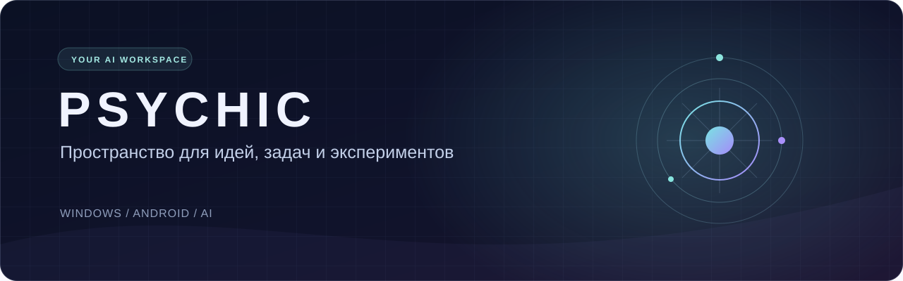

<p align="center">
  
</p>

<p align="center">
  <strong>ИИ-ассистент для Windows и Android</strong><br>
  Чат, инструменты, заметки и творческие эксперименты — в одном приложении.
</p>

<p align="center">
  <a href="#скачать">Скачать</a> ·
  <a href="#что-внутри">Возможности</a> ·
  <a href="#первый-запуск">Первый запуск</a> ·
  <a href="#разработка">Разработка</a>
</p>

---

## Скачать

**Актуальная версия — 1.0.14.** Выбери файл для своего устройства:

| Устройство | Файл | Как использовать |
|---|---|---|
| 🪟 **Windows x64** | [Скачать установщик](https://github.com/Cotyk207/psychic-adventure/releases/download/v1.0.14/PSYCHIC.Setup.1.0.14.exe) | Установи приложение и запускай через меню «Пуск». |
| 🪟 **Windows x64** | [Скачать portable-версию](https://github.com/Cotyk207/psychic-adventure/releases/download/v1.0.14/PSYCHIC-Portable-1.0.14.exe) | Запускай EXE без установки. |
| 🤖 **Android 5.1+** | [Скачать APK](https://github.com/Cotyk207/psychic-adventure/releases/download/v1.0.14/PSYCHIC-Android-1.0.14.apk) | Открой APK на телефоне и следуй подсказкам установки. |

[Все файлы и примечания к релизу →](https://github.com/Cotyk207/psychic-adventure/releases/tag/v1.0.14)

> **Перед установкой.** Android может попросить разрешить установку из этого источника. APK подписан тестовым ключом: подпись может отличаться между сборками, и обновление поверх старой версии не всегда возможно. Перед удалением старой версии сохрани важные данные — удаление приложения может их стереть. Windows может показать предупреждение SmartScreen для неподписанного EXE.

<details>
<summary><strong>Отдельные приложения для сайтов ИИ</strong></summary>

В релизе также есть неофициальные приложения для Arena.ai, ChatGPT, Claude, Gemini, Perplexity и Copilot. Это **не подписки**: они открывают сайты сервисов и не предоставляют платный доступ.

| Сервис | Android | Windows |
|---|---|---|
| **Arena.ai** | [APK](https://github.com/Cotyk207/psychic-adventure/releases/download/v1.0.14/PSYCHIC-Arena-Android-1.0.14.apk) | [EXE](https://github.com/Cotyk207/psychic-adventure/releases/download/v1.0.14/PSYCHIC-Arena-Windows-1.0.14.exe) |
| ChatGPT | [APK](https://github.com/Cotyk207/psychic-adventure/releases/download/v1.0.14/PSYCHIC-ChatGPT-Android-1.0.14.apk) | [EXE](https://github.com/Cotyk207/psychic-adventure/releases/download/v1.0.14/PSYCHIC-ChatGPT-Windows-1.0.14.exe) |
| Claude | [APK](https://github.com/Cotyk207/psychic-adventure/releases/download/v1.0.14/PSYCHIC-Claude-Android-1.0.14.apk) | [EXE](https://github.com/Cotyk207/psychic-adventure/releases/download/v1.0.14/PSYCHIC-Claude-Windows-1.0.14.exe) |
| Gemini | [APK](https://github.com/Cotyk207/psychic-adventure/releases/download/v1.0.14/PSYCHIC-Gemini-Android-1.0.14.apk) | [EXE](https://github.com/Cotyk207/psychic-adventure/releases/download/v1.0.14/PSYCHIC-Gemini-Windows-1.0.14.exe) |
| Perplexity | [APK](https://github.com/Cotyk207/psychic-adventure/releases/download/v1.0.14/PSYCHIC-Perplexity-Android-1.0.14.apk) | [EXE](https://github.com/Cotyk207/psychic-adventure/releases/download/v1.0.14/PSYCHIC-Perplexity-Windows-1.0.14.exe) |
| Copilot | [APK](https://github.com/Cotyk207/psychic-adventure/releases/download/v1.0.14/PSYCHIC-Copilot-Android-1.0.14.apk) | [EXE](https://github.com/Cotyk207/psychic-adventure/releases/download/v1.0.14/PSYCHIC-Copilot-Windows-1.0.14.exe) |

Arena открывается во встроенном браузере со своей сессией; некоторые способы входа могут в нём не работать. Остальные приложения открывают сайты в системном браузере. [Подробнее →](subscription-apps/README.md)

</details>

## Что внутри

| | Возможность | Что можно делать |
|---|---|---|
| 💬 | **Чат с ИИ** | Общаться с моделями, искать по диалогам, цитировать ответы, копировать и экспортировать историю. |
| 🧩 | **Мастерская** | Хранить заметки с тегами и Markdown, пользоваться шаблонами запросов и таймером фокуса. |
| 🌐 | **Каталог ИИ-сайтов** | Находить сайты, добавлять их в избранное и открывать в браузере. |
| 🛠️ | **Ассистент и инструменты** | Работать с файлами, искать информацию, использовать скиллы и память. Доступные действия зависят от платформы и настроек. |
| 🎨 | **Медиа и темы** | Создавать изображения и музыку с доступными провайдерами, менять темы и оформление. |
| 📊 | **Обзор и задачи** | Смотреть системную информацию, открывать разделы и настраивать автоматизацию. |

На Windows доступны дополнительные инструменты компьютера, включая терминал. Android-версия адаптирована для телефона и не повторяет все возможности ПК.

## Первый запуск

1. Установи PSYCHIC и открой приложение.
2. Выбери оформление и подходящий режим доступа к файлам.
3. Нажми на название модели в чате и попробуй раздел **«Без ключа»**.
4. Если сервис недоступен или достигнут лимит, выбери другую модель или провайдера.

В каталоге есть варианты **без API-ключа**: OpenCode, Pollinations, Kilo, OVHcloud, BlockRun и Vireonix. Часть других провайдеров требует регистрации и ключа. Бесплатность, состав моделей и лимиты определяются самими сервисами и могут меняться; работоспособность каждого внешнего сервиса не гарантируется. Для облачных моделей нужен интернет.

Сайты из раздела «ИИ-сайты» открываются отдельно: для некоторых функций или сервисов может понадобиться аккаунт. Введённый в PSYCHIC текст не переносится на эти сайты автоматически.

## Данные и безопасность

- Настройки, диалоги и заметки хранятся на устройстве; **облачные запросы отправляются выбранному поставщику**. Не отправляй секреты и личные данные, если не доверяешь сервису.
- Заметки в «Мастерской» сохраняются кнопкой, не шифруются и входят в экспорт настроек. Они не отправляются модели автоматически.
- Проверяй запрашиваемые разрешения и действия ассистента, особенно запись или удаление файлов и команды терминала. Возможности и ограничения различаются на Windows и Android.
- Экспортируй важные данные перед переустановкой или сбросом приложения.

## Разработка

Нужны Node.js и npm. Для Android-сборки также потребуются Java 17 и Android SDK.

```bash
npm ci
npm run dev             # интерфейс и Electron
npm run check           # синтаксическая проверка
npm test                # unit- и интеграционные тесты
npm run smoke           # проверки интерфейса и Android-рантайма в jsdom
npm run build           # сборка интерфейса
npm run dist            # Windows installer и portable на Windows
npm run build:android   # подготовка Capacitor-проекта
cd android && ./gradlew :app:assembleRelease
```

Исходники приложения находятся в `src/`, Android-проект — в `android/`, отдельные приложения сервисов — в `subscription-apps/`. Сборки и публикация настроены в [GitHub Actions](.github/workflows/build.yml).

## Лицензия

В `package.json` указана лицензия MIT; отдельный файл лицензии в репозитории пока не добавлен.
