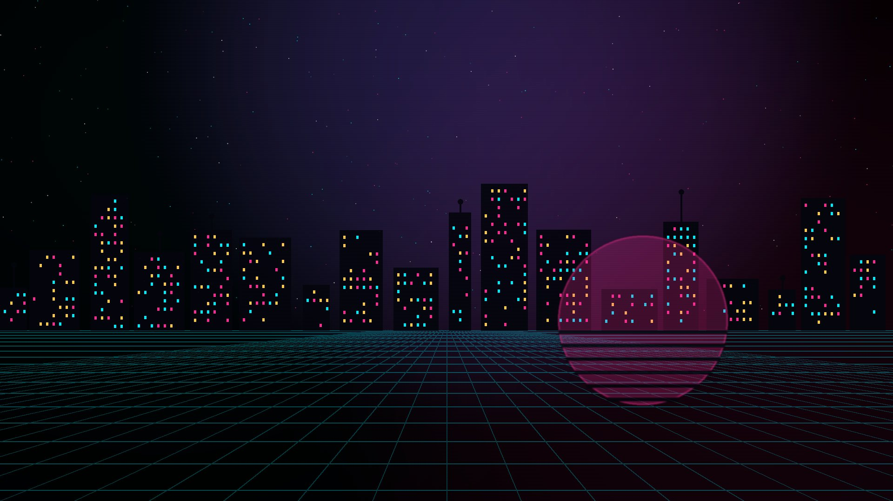

# PSYCHIC

**Локальный киберпанк ИИ-ассистент для Windows.** Работает на твоём ПК, без серверов и подписок:
базовые модели бесплатны и не требуют ключа, платные провайдеры подключаются по желанию.



---

## Возможности

| Блок | Что умеет |
|---|---|
| 💬 Диалог | Стриминг ответа, reasoning-блоки, карта вызовов инструментов, Markdown с подсветкой кода, копирование блоков, зум картинок |
| 🧠 Агент | До 12 шагов на ответ, 28 инструментов: файлы, shell, поиск, браузер, медиа, память, скриншоты |
| 🌐 Поиск | DuckDuckGo / Brave / Tavily / SearXNG — настраивается в настройках |
| 🖥 Компьютер | Чтение и запись файлов, PowerShell/bash, запуск приложений, буфер обмена, скриншоты экрана |
| 🧩 Скиллы | 14 встроенных навыков (кодинг, киберпанк-дизайн, промпты, музыка, терминал…) + создание, импорт из папки/URL, генерация скилла ИИ |
| 🎨 Темы | 10 киберпанк-тем, обои, эффекты, частицы, сканлайны, свой стиль с ручной палитрой |
| 🖼 Медиа | Генерация изображений (Pollinations / Stable Horde / HF / OpenAI-совместимое), музыка (офлайн-синтезатор / HF / Replicate), видео (слайд-шоу / Replicate) |
| 🎵 Музыка | Библиотека, поиск, радио, генератор треков, плеер с эквалайзером |
| 🌍 Браузер | Встроенный WebContentsView: адресная строка, история, чтение страницы, eval JS, скриншоты |
| 📁 Файлы | Дерево, превью текста/картинок/видео/аудио, создание, удаление, «в чат» |
| ⌨️ Терминал | Вкладки xterm.js, PowerShell, живой вывод |
| 🧠 Память | Долгосрочная память с категориями, поиском, экспортом |
| 🔐 Доступ | Режимы: рабочая папка / весь компьютер / только чтение / выбранные папки + список запрещённых путей |
| 🎤 Голос | Speech-to-text и TTS (Web Speech API), горячая клавиша |
| ⚡ Горячие клавиши | `Ctrl+K` — палитра команд, `Ctrl+,` — настройки, `Ctrl+N` — новый диалог, `Ctrl+B` — сайдбар, `Ctrl+1…8` — разделы |

### Бесплатные модели из коробки
- **Pollinations.AI** — текст и изображения **без ключа** (провайдер по умолчанию).
- **OpenRouter** — сотни моделей, часть с суффиксом `:free`.
- **Groq, Mistral, Cerebras, SambaNova, Together, Hugging Face, Zhipu, DeepSeek** — бесплатные лимиты по ключу.
- **Ollama / LM Studio** — локальные модели, определяются автоматически.

Ключ добавляется в **Настройки → Провайдеры**; после сохранения модели появляются в селекторе.
Каталог из 20 провайдеров лежит в `src/shared/providers.json` — свой endpoint добавляется кнопкой
«Свой OpenAI-совместимый».

---

## Установка

1. Скачай **PSYCHIC-Setup-x.x.x.exe** (установщик) или **PSYCHIC-Portable-x.x.x.exe** (без установки)
   со страницы [Releases](../../releases).
2. Установщик: выбери папку, дальнейшее стандартно. Ярлыки на рабочем столе и в «Пуске» создаются автоматически.
3. При первом запуске выбери тему и режим доступа — всё остальное уже работает без ключей.

> Windows 10/11 x64. Портативная версия хранит данные в `%APPDATA%\psychic`, установщик — там же.

---

## Разработка

```bash
npm install          # Electron-бинарь качается с GitHub; при блокировке:
ELECTRON_SKIP_BINARY_DOWNLOAD=1 npm install

npm run dev          # Vite + Electron с hot reload
npm run build        # сборка рендерера в dist/
npm run dist         # Windows-установщик + portable в release/
npm run check        # синтаксис всех .cjs main-процесса
npm run smoke        # headless-рендер всего UI в jsdom (все экраны и вкладки настроек)
```

### Структура

```
src/
├─ main/               Electron main process
│  ├─ index.cjs        окно, CSP, psychic:// протокол, трей, хоткеи
│  ├─ ipc.cjs          ~115 IPC-хендлеров
│  ├─ agent.cjs        цикл агента, стриминг, вызов инструментов
│  ├─ prompts.cjs      системный промпт + скиллы + память
│  ├─ providers/       openai / anthropic / google адаптеры + SSE
│  ├─ tools/           28 инструментов (файлы, shell, браузер, медиа…)
│  └─ services/        поиск, браузер, PTY, медиа, память, скиллы, права
├─ preload/preload.cjs contextBridge → window.psychic
├─ renderer/src/       React 18 + Vite
│  ├─ components/      30+ компонентов
│  ├─ lib/             store, api, темы, Markdown, музыка, видео
│  └─ styles/          6 CSS-файлов дизайн-системы
├─ shared/             providers.json, themes.json
resources/             скиллы, обои, иконка
scripts/               генерация ассетов, синтакс-проверка, smoke-тест
```

### Сборка EXE

EXE собирается в **GitHub Actions** (`.github/workflows/build.yml`): пуш тега `v*` публикует
Release с `PSYCHIC-Setup-*.exe` и `PSYCHIC-Portable-*.exe`. Внятного кросс-компилятора
Windows-приложений в Linux-песочнице нет, поэтому сборка идёт на `windows-latest`.

```bash
git tag v1.0.0 && git push origin v1.0.0
```

Если артефакт окажется слишком большим для GitHub — он заливается на Google Drive,
ссылка добавляется в Release notes.

---

## Безопасность

- По умолчанию включён режим **«Рабочая папка»**: чтение везде, запись только в разрешённые папки.
- Опасные команды (`rm -rf /`, `format`, `del /f /s /q c:` …) блокируются на уровне инструмента.
- Каждый рискованный запрос (запись, shell, сеть) показывается модалкой с аргументами.
- Ключи API хранятся только в локальном конфиге `%APPDATA%\psychic\config\config.json`.
- Весь трафик идёт напрямую в выбранный провайдер — промежуточных серверов нет.

---

## Лицензия

MIT. Используй как хочешь, но не продавай как есть без изменений.
